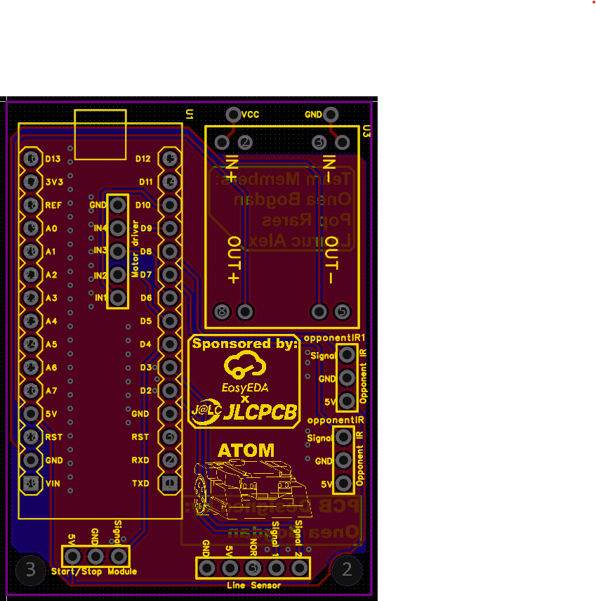

  

# 🤖 Deimos — Mini Sumo Robot

**Deimos** is an autonomous **Mini Sumo robot** built to compete in the 500 g, 10 cm × 10 cm class. Designed for speed, low-center-of-gravity traction, and fast reaction times, Deimos autonomously locates opponents inside the dohyo, avoids ring boundaries, and pushes targets out of the arena.

---

## 📸 Gallery

| Front & Plow View | Custom PCB & Electronics |
| :---: | :---: |
|  |  |

  

---

## ⚙️ Design & Architecture

* **Custom Mainboard PCB:** Compact single-board layout integrating the microcontroller, motor drivers, power regulation, and sensor headers to minimize wiring weight and improve reliability under impact.
* **Opponent & Edge Detection:** Multi-angle distance sensors for rapid target lock-on paired with high-contrast ground sensors to detect the white dohyo border at full speed.
* **High-Torque Drivetrain:** Geared DC motors paired with high-grip silicone wheels and a low-angle front wedge to get underneath opponents.
* **Autonomous Combat Firmware:** Reactive state-machine logic featuring search patterns, edge-escape maneuvers, and full-throttle attack routines.

---

# 🙏 HUGE THANKS TO JLCPCB!

  

<h2 align="center">🤝 Deimos × JLCPCB — Official Project Sponsor</h2>

A massive thank you to **[JLCPCB](https://jlcpcb.com/)** for sponsoring this project and manufacturing the custom printed circuit boards that power **Deimos**. Their fast turnaround, precision fabrication, and consistent board quality made it possible to build a compact, competition-ready electronics package for our mini sumo robot.
